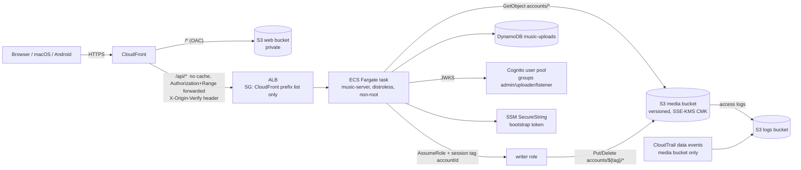

# Running Music Showcase on AWS

Status: implemented on branch `feat/aws-ready`. The access-control contract is `docs/abac.md`; this file covers deployment, the S3 backend, Cognito, AWS-side ABAC, cost and operations. Infrastructure is Terraform in `infra/`; scripts are `scripts/aws-*.sh`.

## Architecture



Without a domain, CloudFront serves its own `https://dXXXX.cloudfront.net` URL and talks to the ALB over plain HTTP. That hop is **a dev smoke test only**; it is restricted to CloudFront addresses by the ALB security group and a shared secret header, but it is not encrypted. With `domain_zone` set, the ALB has an ACM certificate and CloudFront connects over HTTPS.

## Server configuration (environment only)

| Variable | Meaning |
| --- | --- |
| `MUSIC_TOKEN` | Required. Bootstrap admin bearer token (break-glass). On AWS it comes from SSM Parameter Store (SecureString) via the ECS `secrets` block. |
| `MUSIC_STORAGE` | `local` (default) or `s3` (needs a build with `--features aws`; the Dockerfile does that). |
| `MUSIC_S3_BUCKET`, `MUSIC_S3_REGION` | Media bucket and its region. |
| `MUSIC_S3_KMS_KEY_ARN` | The project CMK; every write requests `aws:kms` with this key. |
| `MUSIC_S3_WRITER_ROLE_ARN` | Role assumed per request with session tag `accountId` (AWS-side ABAC). If unset, writes use the task credentials directly. |
| `MUSIC_DDB_TABLE` | DynamoDB upload index table (`music-uploads`). Unset = `uploads.tsv` under `MUSIC_DATA_DIR`. |
| `MUSIC_COGNITO_REGION`, `MUSIC_COGNITO_USER_POOL_ID`, `MUSIC_COGNITO_CLIENT_ID` | Enable Cognito JWT verification. Any OIDC issuer works with `MUSIC_OIDC_ISSUER` + `MUSIC_OIDC_CLIENT_ID` (same claim names). |
| `MUSIC_DENY_SUBJECTS` | Comma list of subject ids forced to `suspended` (emergency revocation). |
| `MUSIC_DEFAULT_QUOTA_BYTES` | Quota for JWT users without `custom:quota_bytes` (default 268435456). |
| `MUSIC_MAX_UPLOAD_BYTES` | Per-object limit (default 104857600). |
| `MUSIC_MAX_CONCURRENT_UPLOADS`, `MUSIC_UPLOAD_TIMEOUT_SECS` | Memory bound (default 4 uploads x one 8 MiB part) and total upload deadline (900 s). |
| `MUSIC_BIND`, `MUSIC_PORT`, `MUSIC_ORIGIN`, `MUSIC_TRUST_PROXY`, `MUSIC_DATA_DIR`, `MUSIC_POLICY_FILE` | Listen address (container: `0.0.0.0`), port, the single allowed CORS origin (set to the CloudFront URL), trust `X-Forwarded-Proto` for `env.secure`, data directory, optional policy file. |

Credentials: the AWS SDK **default credential chain only** (the task role on ECS). No keys appear in config, images or this repo.

## Behaviour of the S3 backend

- **Keys** are `accounts/<ownerId>/<trackId>.<ext>`. Every key is parsed strictly before it reaches S3 (owner `[a-z0-9_-]{1,64}`, 16 hex id, one of five extensions), so `..`, extra segments or odd characters are refused.
- **Upload**: the server decides (ABAC, size, quota) from the headers, then sniffs the first bytes, then streams. Up to 8 MiB is one `PutObject`; larger bodies use multipart with one 8 MiB part in memory at a time. Any failure (client disconnect, short body, part error, timeout) calls `AbortMultipartUpload`; a lifecycle rule aborts anything left after 1 day as a backstop. `Content-Type` is set from the sniffed format, never from the client.
- **Encryption**: every write sends `ServerSideEncryption=aws:kms` with the project key. At startup the server reads the bucket's default encryption and **refuses to start** unless it is SSE-KMS or SSE-S3; `storage.encrypted` then feeds the `deny-s3-unencrypted` policy rule.
- **Delete** writes a delete marker (the bucket is versioned), so the current object is gone but versions stay for 30 days.
- **Quota**: usage is the in-memory sum over the upload index plus bytes reserved by in-flight uploads, so parallel uploads cannot overshoot (tested).

### Upload index: DynamoDB

Table `music-uploads`, partition key `ownerId`, sort key `id`, on-demand billing, point-in-time recovery. The server loads the table at start (a consistent `Scan`) and writes through on every change, so "used bytes per account" is an in-memory sum, not a query. **This assumes a single writer: keep `desired_count = 1`.** The ECS service deploys stop-then-start for the same reason. Scaling out needs a GSI on `id`, a conditional counter item per account, and dropping the cache; it is deliberately not built.

## Streaming decision: proxy through the server

We chose **(a) proxy the bytes through the server**.

- ABAC is enforced on every request and every byte; a presigned URL (option b) is a bearer credential that outlives the decision for up to 5 minutes and shows up in logs and history.
- The existing `206`/`416`/`304`/`HEAD` behaviour is unchanged, and **no client changes are needed**. Under option (b) players would have to follow a cross-origin redirect and drop the `Authorization` header correctly; web `<audio>` cannot send the header at all, so the web client would first need to move to a different mechanism.
- Throughput of one 0.25 vCPU task is plenty for a demo. If streaming ever dominates cost, switch to (b) for public tracks only.

Ranges are passed to S3 as `GetObject` `Range` and streamed through a bounded channel (4 chunks), so memory per stream is constant.

## Authentication

Local bearer tokens (`accounts.tsv`, bootstrap `MUSIC_TOKEN`) keep working unchanged. With the Cognito variables set, a bearer value that looks like a JWT (two dots) is verified instead:

- RS256 only (never `none`/HS256); signature against the pool's JWKS (cached, refreshed at most once a minute on an unknown `kid`); `iss`; `exp` (30 s leeway); `aud` for an **ID token** or `client_id` for an access token.
- Claims map to subject attributes: `sub` -> `id`, `custom:role` -> `role` (else the highest `cognito:groups` entry, else `listener`), `custom:status` (default `active`; unknown values become `suspended`) -> `status`, `custom:quota_bytes` -> `quotaBytes`.
- Cognito puts custom attributes only in **ID tokens**, so clients should send the ID token as the Bearer token.
- Users cannot edit `custom:*`: the app client's `write_attributes` is `email` only. Sign-up is admin-only. The app client is public (no secret), authorization-code + PKCE, SRP for direct sign-in, and, in dev only, `ALLOW_ADMIN_USER_PASSWORD_AUTH` so IAM-signed test tooling can mint tokens.
- Token validity is 15 minutes; role/status/quota changes apply at the next refresh. For an immediate cut-off use `deny_subjects`.

`id` is now `[a-z0-9_-]{1,64}` (it was 32) so a Cognito `sub` UUID can be used verbatim.

## AWS-side ABAC (defence in depth)

The application's ABAC stays authoritative. In addition:

- The server's **task role** can read `accounts/*`, use the index table and assume the writer role. It has **no** `PutObject`/`DeleteObject`.
- Writes and deletes run under a short-lived session of the **writer role**, assumed with `Tags=[accountId=<owner of the key>]`. Its policy allows `s3:PutObject`, `s3:AbortMultipartUpload`, `s3:DeleteObject` only on `accounts/${aws:PrincipalTag/accountId}/*`, plus the KMS key, and explicitly denies everything when the tag is missing. It cannot read, and cannot `DeleteObjectVersion` (so versions stay restorable).
- The writer's trust policy admits only the task role, requires the `accountId` tag, and rejects any other session tag key.
- So even a server bug that wrote to the wrong owner prefix would be refused by IAM.

Proof: `python3 infra/tests/policy_lint.py` (offline; mismatching tag is denied, missing tag is denied, no wildcard Allow actions) and `infra/tests/abac-simulate.sh` (live `aws iam simulate-principal-policy` against the deployed role).

Two wildcard uses are intentional: the writer policy's *Deny* statement (`Action: *`, `Resource: *`, only when the tag is missing) and the AWS-managed `AmazonECSTaskExecutionRolePolicy` on the execution role (AWS requires `*` for ECR auth and log delivery). Nothing else uses `*` actions.

## Bucket hardening (media)

Private; Block Public Access (all four); `BucketOwnerEnforced`; versioning; SSE-KMS with a customer-managed key (rotation on) and bucket keys; policy denying non-TLS requests, any `PutObject` that does not request `aws:kms`, and any `PutObject` naming a different KMS key; access logs to a second bucket; lifecycle: noncurrent versions expire after 30 days, incomplete multipart uploads abort after 1 day, expired delete markers are cleaned; CORS only for the app origin, `GET`/`HEAD`, header `Range`, exposing `Content-Range` and `Accept-Ranges`. CloudTrail records **data events for the media bucket only** (no management events).

## Cost estimate (us-east-1, light use, left running 24x7)

| Item | Approx. USD / month |
| --- | --- |
| Application Load Balancer (hours + minimal LCUs) | 17.5 |
| Fargate, Graviton, 0.25 vCPU / 0.5 GB | 7.2 |
| Public IPv4 addresses: 2 for the ALB, 1 for the task (no NAT gateway) | 11.0 |
| KMS customer key | 1.0 |
| CloudWatch (3 alarms, 14-day logs, S3 request metrics) | 2-3 |
| CloudTrail data events, S3, DynamoDB, ECR, SSM, SNS | 1-2 |
| CloudFront (always-free tier covers light use), Cognito (under 10k MAU), Budgets, ACM | 0 |
| **Total** | **about 40** (about 1.35 per day, about 0.06 per hour) |

A verification session of a couple of hours costs roughly 0.15. **Running continuously exceeds a small budget cap; destroy when you are done.** Alternatives considered: App Runner is not enabled for the target account (`SubscriptionRequiredException`); Lambda function URLs cap request bodies at 6 MB, which breaks the 100 MB multipart upload design. WAF is off; enabling it (`enable_waf = true`: Common rule set + a rate limit on CloudFront) adds about 7 USD/month plus 0.60 per million requests.

## Verification (what `scripts/aws-verify.sh` runs)

Through the CloudFront URL with real Cognito tokens: no token -> 401; an uploader's MP3 upload -> 201; ranged stream -> 206 with the exact bytes; a second account reading the private track -> 404; a listener upload -> 403; second upload beyond quota -> 403 `quota_exceeded`; non-audio -> 415. Against S3 directly: the object sits at the contract key with `audio/mpeg` and SSE-KMS; a put without encryption headers, a put with SSE-S3, and a plain-HTTP request are all denied by the bucket policy, while an SSE-KMS put with the project key succeeds (control); deleting the track leaves a delete marker so `head-object` fails and the version is still listed. Budget, alarms and the trail are checked, and the IAM simulation runs.

## Runbook

**Rotate the bootstrap admin token.** `terraform -chdir=infra apply -replace=random_password.admin_token -var-file=...`; the new value lands in SSM and ECS restarts the task on the next deployment (`aws ecs update-service --force-new-deployment`). Refresh `~/.music-showcase/admin.token` with `scripts/aws-deploy.sh apply`.

**Rotate the KMS key.** Automatic rotation is on (yearly, same key id, old key material kept for decryption). To move to a new CMK: create it, update `kms.tf`/`MUSIC_S3_KMS_KEY_ARN`, apply, then re-encrypt existing objects in place with `aws s3 cp s3://BUCKET/accounts/ s3://BUCKET/accounts/ --recursive --sse aws:kms --sse-kms-key-id NEWKEY` before scheduling the old key for deletion.

**Restore a deleted object.** The delete wrote a delete marker; removing the marker restores the previous version:
```
aws s3api list-object-versions --bucket BUCKET --prefix accounts/OWNER/TRACKID.mp3 --query 'DeleteMarkers[?IsLatest].VersionId'
aws s3api delete-object --bucket BUCKET --key accounts/OWNER/TRACKID.mp3 --version-id MARKER_VERSION_ID
```
The upload-index row was removed by the delete, so also recreate it (an `aws dynamodb put-item` on `music-uploads` with the row's attributes), then restart the service so it reloads the index. Versions older than 30 days are gone.

**Revoke an account.** `scripts/aws-user.sh revoke <email>` disables the user and signs them out everywhere; tokens already issued live up to 15 minutes. For an immediate cut-off add the user's `sub` to `deny_subjects` and apply (about 2 minutes). To keep the account but stop it, `scripts/aws-user.sh set <email> <role> suspended`.
